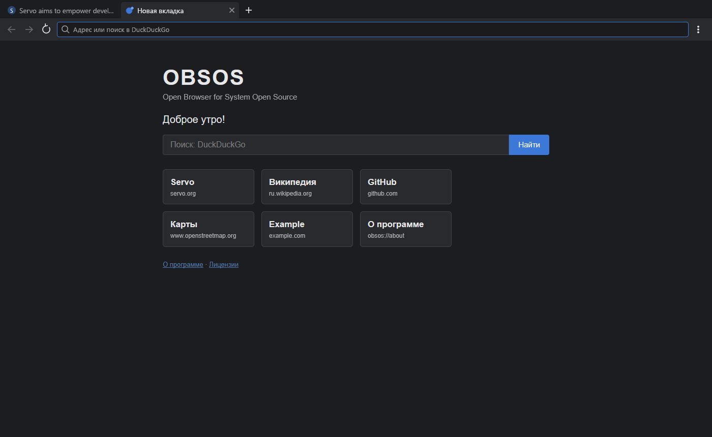
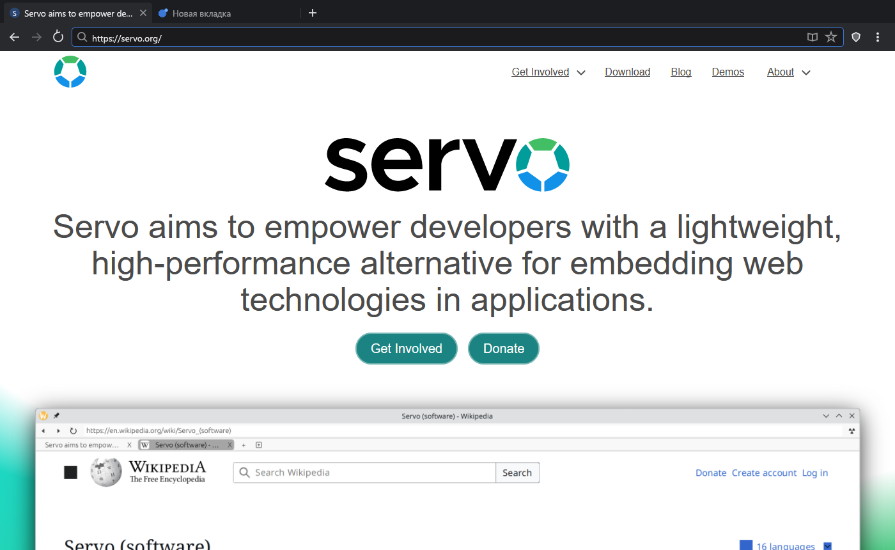
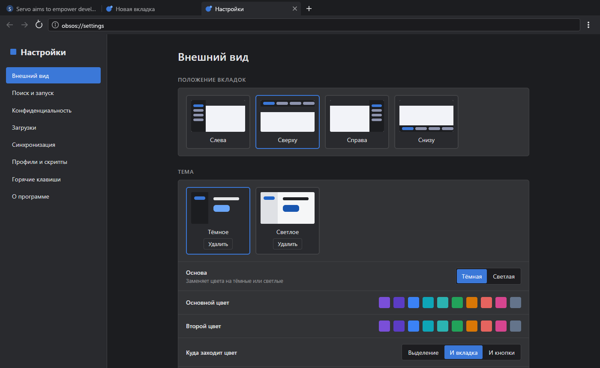
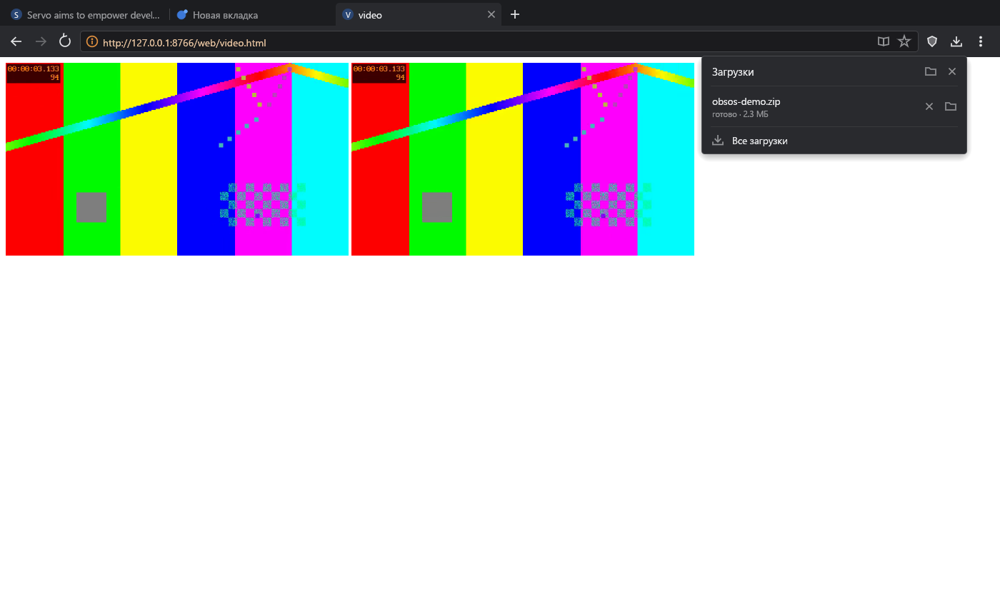
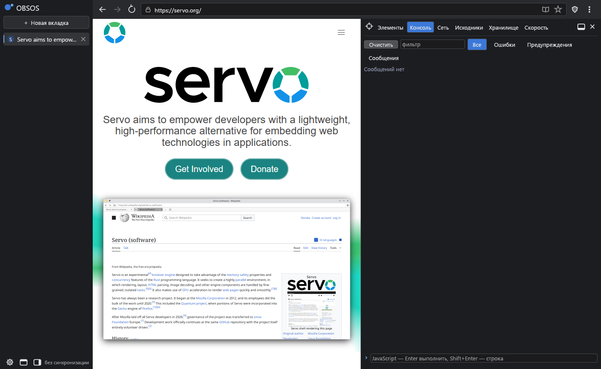
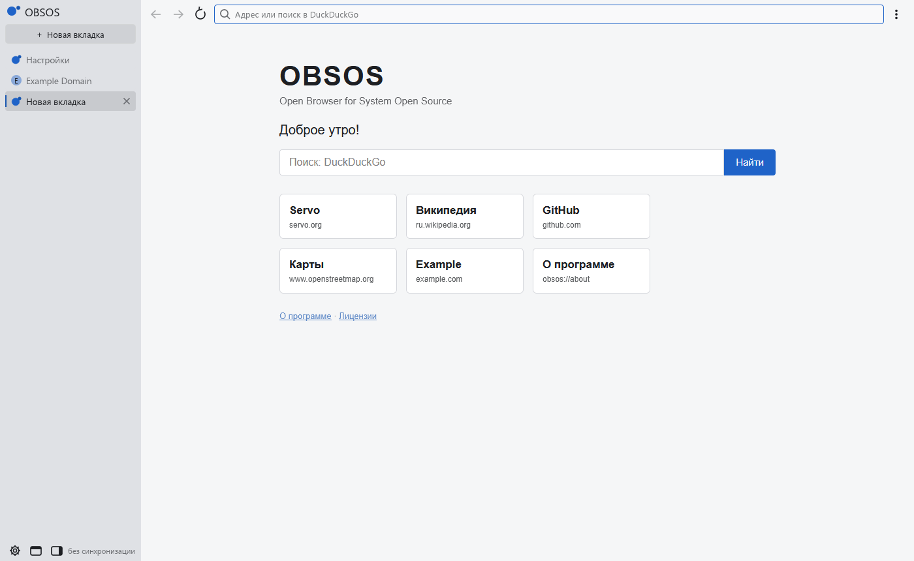

# OBSOS — Open Browser for System Open Source

Браузер на [Servo](https://servo.org) 0.8: свой интерфейс (вкладки сверху или
сбоку, омнибокс, история, закладки, зашифрованные пароли, синхронизация через
свой репозиторий GitHub/GitLab/Bitbucket, Яндекс Диск, Google Диск, WebDAV или
папку, загрузки, блокировка рекламы, режим чтения, инструменты разработчика,
пользовательские скрипты и стили). Родился внутри ОС
[FossAi](https://github.com/anomal3/FreeOpenSourceSystemAI) и вынесен оттуда 25.11.2026, чтобы его можно было
разрабатывать и отлаживать прямо на Windows (и Linux), а в FossAi подключать
готовым.

**Скачать для Windows** — [последний выпуск](https://github.com/anomal3/OBSOS/releases/latest):
распаковать архив и запустить `obsos.exe` (Windows 10/11 x64, установка не
нужна). Это ранняя версия: движок Servo молодой, часть сайтов выглядит или
работает не так, как в Chrome и Firefox.

| | |
|---|---|
|  |  |
|  |  |
|  |  |

## Как устроено

```
obsos-core/      оболочка без привязки к ОС: Servo, swgl, egui, вкладки, профиль,
                 пароли (vault), синхронизация (syncer), загрузки, страницы obsos://,
                 скрипт страниц (shell::PAGE_SCRIPT), главный цикл (app::run);
                 договор с платформой — obsos-core/src/window.rs
obsos-desktop/   Windows и Linux: окно winit, кадр softbuffer, буфер обмена arboard,
                 окна выбора файла rfd → программа obsos(.exe)
obsos-fossai/    FossAi: окно стола FossAi (freeos_window_*), syscalls, /bin/filedlg;
                 программы browser (в пакете — /opt/obsos/bin/obsos) и servoprobe
crates/browser-sync/   ядро синхронизации (журналы операций, HLC, площадки)
third_party/egui-software-backend/   копия с правкой (холст обновляется при исчезновении фигуры)
patches/         правки Servo (patches/README.md) и список шрифтов FossAi
xtask/           cargo xtask vendor — готовит vendor/ с правленными крейтами Servo
assets/icons/    значок OBSOS
docs/NOTICE.md   лицензии (страница obsos://licenses)
```

На Windows всё окно рисует **видеокарта** (`obsos-core/src/gpu_ctx.rs`):
страницы всех окон — в один общий буфер (surfman/WGL), у каждого окна свой
участок (`windows.rs`), оболочка egui — через `egui_glow`, показ по частоте
экрана. На FossAi и с ключом `--swgl`
всё рисует процессор (swgl и egui прямо в пиксели). От платформы нужны
поверхность окна и события (в кодировке окна FossAi, `WinEvent`), для
видеокарты — ещё дескрипторы окна (`HostWindow::gl_handles`).

## Что умеет оболочка

* Вкладки сверху (по умолчанию; на FossAi — слева), слева, справа или снизу
  (настройки, меню «⋮», правая кнопка на вкладке); перетаскивание, значки
  сайтов, меню вкладки.
* Несколько окон (Ctrl+N, с видеокартой): вкладку можно вытянуть мышью в своё
  окно и вернуть в полосу другого — страница при этом не перезагружается.
* Адресная строка с подсказками из истории и закладок.
* Страницы `obsos://settings`, `obsos://history`, `obsos://bookmarks`,
  `obsos://downloads` (`webui.rs`, команды — только от них самих,
  `webui_host.rs`).
* Инструменты разработчика (F12; справа или снизу): элементы со стилями и
  блочной моделью, выбор элемента (Ctrl+Shift+C), консоль, сеть, исходники,
  хранилище (куки, local/sessionStorage), скорость загрузки. Отладчик с
  точками останова — Firefox: `obsos --devtools`, затем в Firefox
  `about:debugging` → `localhost:6080`.
* Масштаб интерфейса (как у системы или свой) и страниц, плавная прокрутка,
  полный экран (F11), Ctrl+колесо, боковые кнопки мыши.

### Обходы пробелов движка

Скрипт страниц (`shell::PAGE_SCRIPT`) дорисовывает то, чего Servo не умеет:
`fill="var(--…)"` в SVG (иначе чёрные прямоугольники) и «градиентный текст»
(`background-clip: text` — буквы красятся первым цветом градиента).

История файлов перенесена из репозитория FossAi (`git filter-repo`): `git log
--follow obsos-core/src/shell.rs` показывает и прежние коммиты.

## Сборка и запуск на Windows

Нужно (на ПК Романа всё уже есть):

* Rust через rustup — ночная сборка из `rust-toolchain.toml` ставится сама;
* Visual Studio Build Tools (MSVC, Windows SDK) — линковщик;
* LLVM (clang-cl) — swgl и C++ Servo собираются им, `cl.exe` swgl не берёт;
* Python 3 — генерация кода Servo (`PYTHON3`).

SpiderMonkey (`mozjs_sys`) на Windows не собирается из исходников — его
build.rs скачивает готовую библиотеку с github.com/servo/mozjs.

Одной командой (с видео, если есть GStreamer):

```bat
powershell -ExecutionPolicy Bypass -File tools\build-windows.ps1
target\release\obsos.exe https://servo.org
```

Или вручную, без видео:

```bat
cargo xtask vendor
set CC=clang-cl
set CXX=clang-cl
set PYTHON3=C:\Python314\python.exe
cargo build --release
```

Архив для выпуска (только нужные DLL, без GPL-библиотек GStreamer):
`tools\build-windows.ps1 -Dist`, затем `tools\package-windows.ps1` → `dist\`.

Первая сборка — от 6 до 40 минут и ~15 ГБ в `target\` (release; отладочная
сборка Servo заняла бы ещё столько же). Дальше пересобирается только OBSOS.
Окна консоли рядом с браузером нет: журнал `browser: …` (страницы, сеть,
ошибки скриптов страниц) пишется в `%USERPROFILE%\.config\obsos\obsos.log`
(прошлый запуск — `obsos.old.log`); `--console` открывает консоль, а
перенаправление (`obsos > журнал.txt`) работает как обычно.

**Видео и звук** — фича `video` (`cargo build --release --features video`):
нужен GStreamer 1.26 MSVC x86_64 (runtime и devel с gstreamer.freedesktop.org;
можно только распаковать: `msiexec /a <msi> /qn TARGETDIR=<папка>`; у devel
распаковка спотыкается на шаблонах Visual Studio — их можно убрать из копии
пакета) и его DLL с плагинами рядом с `obsos.exe` (это делает скрипт).
Потоковое видео (YouTube: Media Source Extensions) Servo не умеет и с ним.

Ключи: `obsos [--profile <имя>] [--private] [--sync-folder <папка>]
[--size ШxВ] [--swgl] [--devtools [порт]] [--pref имя=значение] [адрес]`.

### Проверка без человека

`obsos --control <файл>` выполняет команды, дописываемые в файл: переход,
щелчки, клавиши, набор, `eval`, снимок окна в BMP, замеры времени кадра
(список — в `obsos-core/src/automation.rs`). Так проверяются изменения
интерфейса и скорости.

Данные: `%USERPROFILE%\.config\obsos\<профиль>` (настройки, закладки, история,
пароли), `%USERPROFILE%\.config\servo` (куки, localStorage, IndexedDB),
загрузки — `%USERPROFILE%\Downloads`.

На Linux то же самое (`cargo build --release`, нужен clang); окна выбора
файла — через портал xdg.

## Как FossAi получает OBSOS

FossAi собирает программы со `std` под `<арх>-unknown-freeos` в контейнере
`fossai-builder` (Docker, `ports/servo/builder` в репозитории FossAi): там его
sysroot, обёртка компилятора, правки std, SpiderMonkey под FreeOS
(`ports/servo/mozjs`) и `aws-lc-sys` с `getentropy`. Этот репозиторий
монтируется в контейнер (`/obsos`), версия закреплена в FossAi файлом
`ports/servo/OBSOS_REV`:

```sh
docker run --rm -v <FossAi>:/work -v <OBSOS>:/obsos -v fossai-servo:/cache \
    -v fossai-cargo-registry:/opt/cargo/registry \
    fossai-builder sh /work/ports/servo/builder/build-servoprobe.sh x86_64
```

Скрипт делает `cargo xtask vendor` здесь, собирает `obsos-fossai` и кладёт
`browser` и `servoprobe` в `build/linux/servo-browser-<арх>` и
`servoprobe-<арх>` FossAi — оттуда их берёт `cargo xtask` FossAi в пакет
`obsos-0.1.fpk` (и в том для телефона).

## Что ещё не так, как на FossAi

* Масштаб экрана учитывается на Windows/Linux; на FossAi окно сообщает 1.
* Видеокарта — только на Windows; на Linux и FossAi рисует процессор.
* «Открыть в Chromium» на Windows/Linux открывает браузер системы по умолчанию.
* Пробелы Servo 0.8: нет Media Source Extensions (YouTube), WebGL, CSS-масок
  (часть значков — чёрными квадратами, например в Википедии).
* Без фичи `video` (и на FossAi) `<video>` никогда не сообщает о загрузке:
  событие `load` не наступает, а некоторые страницы (github.com) падают.

## Лицензия

Свой код OBSOS — © 2026 Roman <anomal3@yandex.ru>, на выбор под одной из
двух лицензий:

* MIT — [LICENSE-MIT](LICENSE-MIT);
* Apache License 2.0 — [LICENSE-APACHE](LICENSE-APACHE).

Пользоваться, менять и встраивать OBSOS в свои программы (в том числе
закрытые) можно свободно, сохраняя уведомление об авторстве. Если не
сказано иначе, присланный в проект код тоже лицензируется как
`MIT OR Apache-2.0`, без дополнительных условий.

Сторонний код остаётся под своими лицензиями (полный список — в
[docs/NOTICE.md](docs/NOTICE.md), страница `obsos://licenses`):

* движок **Servo** 0.8 (зависимость с crates.io), SpiderMonkey, swgl/WebRender
  — MPL-2.0. Правки крейтов Servo, которые вносит `cargo xtask vendor`, и
  `patches/fonts/font_list.rs` — тоже MPL-2.0 (MPL действует пофайлово:
  исправленные файлы Servo остаются под MPL, остальной код OBSOS — нет);
* `third_party/egui-software-backend` — копия крейта
  [egui_software_backend](https://github.com/DGriffin91/egui_software_backend)
  (© DGriffin91) с правкой, MIT или Apache-2.0, файлы лицензий лежат рядом;
* дизайн оболочки — по мотивам [Zervo](https://github.com/Goddv/Zervo)
  (© Goddv, MPL-2.0); код оболочки свой.
